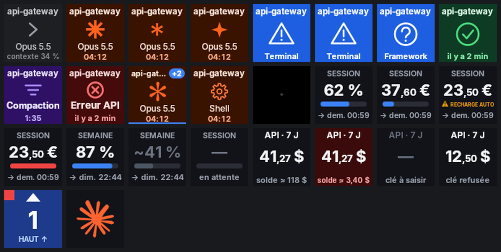
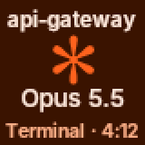

# ClaudeDeck

Moniteur d'activité **Claude Code** sur **Stream Deck Mini** (6 touches), pour Windows 10/11.
**Aucun pilote ni logiciel Elgato requis** : ClaudeDeck parle directement au périphérique via le pilote HID générique de Windows.

```
┌───────────────┬───────────────┬───────────────┐
│  session 1    │  session 2    │  session 3 +N │   ← sessions Claude Code (couleur = état, appui = focus)
├───────────────┼───────────────┼───────────────┤
│    SESSION    │   SEMAINE     │     logo      │   ← limites du forfait Pro/Max
│ 62 % → 18:43  │ 23 % → jeu.   │  (ou API 7 j) │
└───────────────┴───────────────┴───────────────┘
```

 

## Ce que ça affiche

**Ligne du haut — jusqu'à 3 sessions Claude Code locales** (CLI dans Windows Terminal ou VS Code, extension VS Code).
Priorité automatique : *en attente* > *erreur* > *travaille* > *terminé* > *au repos*, puis la plus récente.
Une session garde sa touche tant qu'elle reste affichée ; la pastille « +N » signale les sessions masquées
(orange si l'une d'elles attend une action).

| État | Couleur | Déclencheur (hooks Claude Code) |
|---|---|---|
| Au repos | gris, invite « > », modèle et remplissage du contexte (« ≈ » si estimé) | `SessionStart`, Échap (`Notification` idle) |
| Travaille | orange très sombre, astérisque animé (2 s, déphasé d'une touche à l'autre), modèle (« Opus 5.5 ») et chrono du tour (`mm:ss` ou `h:mm:ss`, chiffres à largeur fixe) | `UserPromptSubmit`, `PreToolUse`, `PostToolUse` |
| **Autoriser / Question** | **bleu**, clignotant pendant 10 s puis fixe, icône seule (triangle ou « ? ») ; en bas, l'outil concerné ou le titre de la question (`header` d'AskUserQuestion) | `PermissionRequest`, `Notification` (permission, elicitation), `AskUserQuestion` |
| Tâche de fond | couleurs du travail, roue crantée en lignes, lente, « Shell », chrono qui continue : Claude a fini, une commande lancée en arrière-plan tourne encore | `Stop` avec une tâche `shell` dans `background_tasks` |
| Terminé | vert, coche seule, « il y a 3 min » | `Stop` |
| Compaction | violet | `PreCompact` → `PostCompact` |
| Erreur API | rouge | `StopFailure` |

**Appui sur une session** : met au premier plan la fenêtre qui l'héberge (VS Code — la bonne fenêtre si plusieurs —
ou Windows Terminal) et acquitte l'état « terminé ».

**Ligne du bas — jauges**

1. **Session** (fenêtre de 5 h) du forfait Pro/Max : % consommé et heure de réinitialisation.
   Couleur de la jauge : bleu jusqu'à 90 %, orange jusqu'à 95 %, rouge au-delà.
   Session épuisée (100 %) avec les **crédits d'utilisation** activés : la tuile affiche le **solde de crédits**
   prépayés (dans la devise du compte) au lieu de 100 %. La jauge montre la part du plafond de dépense mensuel ; sans
   plafond, elle est remplacée par « ⚠ RECHARGE AUTO » si la recharge automatique est activée, sinon elle reste pleine
   en rouge jusqu'à la réinitialisation de la session. Pendant ce temps, ClaudeDeck interroge la source OAuth chaque
   minute, ce qui fait aussi apparaître rapidement une réinitialisation (y compris « Réinitialiser gratuitement » sur
   claude.ai). Un appui sur la tuile force la mise à jour.
2. **Semaine** : % consommé et jour + heure de réinitialisation.
3. **Logo** (par défaut) : le logo de Claude (`assets/logo/default-logo.png`, marque d'Anthropic, non couvert par la
   licence MIT), ou votre propre image (réglage « Image du logo », PNG/JPG redimensionné automatiquement).
   **Appui : ouvre [claude.ai/new](https://claude.ai/new)** dans le navigateur par défaut (nouvel onglet ; option
   « nouvelle fenêtre » dans les réglages), même si l'écran est en veille. Adresse modifiable, vide = aucune action.
   En option, **API · 7 jours** : dépense de l'organisation (Admin API) et **solde estimé** — nécessite un compte
   Console **d'organisation** (voir plus bas).

Appuyer sur une jauge force un rafraîchissement. L'écran baisse en veille après 15 min sans activité
(jamais si une session travaille ou attend), et s'éteint quand Windows est verrouillé.

## Installation

Deux variantes, dans les [Releases](https://github.com/rdejeun/claude-deck/releases) :

| Variante | Taille | Prérequis |
|---|---|---|
| `claude-deck-light-win-x64.zip` (recommandée) | 6 Mo | [.NET 8 Desktop Runtime](https://dotnet.microsoft.com/download/dotnet/8.0) (`winget install Microsoft.DotNet.DesktopRuntime.8`) |
| `claude-deck-portable-win-x64.zip` | 68 Mo | aucun (runtime .NET embarqué) |

Ou compilez-le vous-même (voir [Antivirus](#antivirus-et-smartscreen)).

1. Décompressez le zip dans un dossier **définitif** (par ex. `C:\Outils\ClaudeDeck`) et lancez `claude-deck.exe`.
   ClaudeDeck ne se copie nulle part : Claude Code l'appellera à cet emplacement.
2. **Quittez le logiciel Stream Deck d'Elgato** s'il est installé (et désactivez son démarrage automatique) :
   il se disputerait l'écran. ClaudeDeck vous prévient s'il le détecte.
3. Clic droit sur l'icône ClaudeDeck (zone de notification) → **Installer l'intégration Claude Code** : ajoute dans
   `%USERPROFILE%\.claude\settings.json` des hooks de type `http` vers `http://127.0.0.1:47777/hook` et une status line
   `claude-deck.exe statusline` (sauvegarde horodatée du fichier avant écriture ; vos hooks existants sont conservés,
   et votre status line existante continue de s'afficher).
4. Optionnel : menu → **Démarrer avec Windows** (clé `Run` de HKCU, sans droits administrateur).
5. Redémarrez vos sessions Claude Code (les hooks sont lus au démarrage).
6. Menu → **Mire de test** : chaque touche doit afficher son numéro (1-2-3 en haut), une flèche vers le haut et un carré
   rouge en haut à gauche. Sinon, ajustez rotation / miroirs dans les réglages.

Si vous déplacez le dossier ou passez à une nouvelle version, refaites l'étape 3 (ClaudeDeck vous le signale).
En ligne de commande : `claude-deck.exe install` / `claude-deck.exe uninstall`.

### Antivirus et SmartScreen

ClaudeDeck n'est **pas signé numériquement** (un certificat de signature de code est payant) : un antivirus peut donc
bloquer le zip ou l'exécutable par simple méfiance envers un programme inconnu (détections « heuristiques » ou « ML »
du type `Trojan:Win32/Wacatac…!ml`, `Gen:Variant…`, « réputation faible »). Le programme a été conçu pour limiter
ces faux positifs : pas d'exécutable compressé, pas d'auto-copie, pas d'inscription automatique au démarrage,
aucune saisie clavier simulée, et pas de `createdump.exe` (outil de vidage mémoire du runtime .NET, souvent classé
« HackTool » ; retiré de la variante portable depuis la v0.2.1).

Si votre antivirus bloque malgré tout :

- **Compilez depuis les sources** (le plus sûr : vous lisez ce que vous exécutez). Avec le
  [SDK .NET 8](https://dotnet.microsoft.com/download/dotnet/8.0) (`winget install Microsoft.DotNet.SDK.8`) :
  ```powershell
  git clone https://github.com/rdejeun/claude-deck
  cd claude-deck
  powershell -ExecutionPolicy Bypass -File .\build.ps1
  .\publish\claude-deck.exe
  ```
- **Vérifiez l'empreinte** du fichier téléchargé avec `SHA256SUMS.txt` de la release :
  `Get-FileHash .\claude-deck-light-win-x64.zip`.
- **Signalez le faux positif** à l'éditeur (Microsoft Defender :
  [microsoft.com/wdsi/filesubmission](https://www.microsoft.com/en-us/wdsi/filesubmission)), puis restaurez le fichier
  depuis la quarantaine une fois la détection levée. Évitez de désactiver l'antivirus ; une exclusion limitée au seul
  dossier de ClaudeDeck suffit si vous avez vérifié le code.

### Réglages (page web locale)

Double-clic sur l'icône → `http://127.0.0.1:47777/settings` : aperçu en direct des 6 touches (cliquables),
sessions suivies, jauges, luminosité, veille, orientation, et :

- **Clé Admin API** (`sk-ant-admin…`, Console → Settings → Admin keys) : stockée chiffrée par DPAPI dans votre profil
  Windows, utilisée uniquement pour `GET /v1/organizations/cost_report`.
  La page *Admin keys* n'apparaît que dans un **compte d'organisation**, pour le rôle **admin** ou **propriétaire** :
  un compte individuel doit d'abord créer son organisation (Console → Settings → Organization).
  Une **clé personnelle** (*Linked account* = vous) **non limitée à un espace de travail** est aussi acceptée par l'Admin API.
  Ces réglages n'apparaissent que si la touche en bas à droite est en mode « Dépense API ».
- **Solde** : aucune API publique ne fournit le solde de crédit prépayé. Saisissez le montant affiché dans la Console
  (Billing) après chaque recharge ; ClaudeDeck affiche ensuite `solde ≈ saisi − dépense mesurée depuis`.

Fichiers : `%APPDATA%\ClaudeDeck\` (`config.json`, `plan-usage.json`, `logs\claude-deck.log`, secret chiffré).

## Sources des jauges du forfait — à savoir

Les pourcentages 5 h / semaine viennent du champ officiel `rate_limits` que Claude Code transmet à la **status line**
(Pro/Max uniquement, après la première réponse de la session). Conséquences :

- ils sont mis à jour **quand une session CLI tourne** ; sinon la dernière valeur reste affichée, puis grisée (`~`) après 30 min ;
- **l'extension VS Code n'exécute pas de status line** : si vous n'utilisez qu'elle, activez dans les réglages
  « Source OAuth non documentée ». ClaudeDeck interroge alors toutes les 5 min l'endpoint `/api/oauth/usage` qu'utilise
  la commande `/usage`, avec le jeton de `~/.claude/.credentials.json` (lecture seule, jamais rafraîchi par ClaudeDeck).
  Cet endpoint n'est **pas documenté** : il peut changer ou disparaître sans préavis. Désactivé par défaut.

## Sécurité

- Le serveur n'écoute que sur `127.0.0.1`, vérifie l'en-tête `Host` (anti DNS-rebinding) et exige un jeton aléatoire
  (`X-ClaudeDeck-Token`, inscrit dans les hooks) : une page web ne peut pas forger d'événements.
- Les hooks répondent immédiatement avec un corps vide : ClaudeDeck **n'approuve ni ne refuse jamais rien** à votre place.
  Si le daemon est arrêté, Claude Code continue normalement (échec de hook non bloquant).

## Limites connues (v1)

- Sessions **claude.ai/code (cloud)** non suivies.
- Windows Terminal : le focus amène la bonne fenêtre, pas le bon onglet.
- Console Windows « classique » (conhost) : le focus peut ne pas trouver la fenêtre.
- Windows peut refuser le changement de premier plan dans certains cas (l'icône de la barre des tâches clignote alors).
- Exécutable non signé : voir [Antivirus et SmartScreen](#antivirus-et-smartscreen).
- Animation « travaille » : affichage à 12 images/s (réglage `display.animationFps`) ; si le débit USB du Stream Deck
  ne suit pas, des images sont sautées. Autres choix dans les réglages : anneau, ou votre propre GIF.

## Développement

Prérequis : SDK .NET 8. Tout se compile aussi sous Linux/macOS (sauf l'exécution de l'appli Windows).

```bash
dotnet test tests/ClaudeDeck.Tests
```

```bash
dotnet run --project src/ClaudeDeck.Sim -- --demo
```

Le simulateur lance le daemon complet sans matériel, avec un scénario de démonstration ; aperçu sur
`http://127.0.0.1:47777/preview`. `--gallery <dossier>` rend chaque état de touche en PNG.

```bash
dotnet publish src/ClaudeDeck -c Release -p:SelfContained=false -o publish
```

Sous Windows, `build.ps1` enchaîne tests et publication (`-Variant light|portable`).

Architecture et protocole : [docs/SPEC.md](docs/SPEC.md).

## Licence

MIT. Composants tiers : [THIRD-PARTY-NOTICES.md](THIRD-PARTY-NOTICES.md).
« Stream Deck » est une marque d'Elgato ; projet non affilié à Elgato ni à Anthropic.
